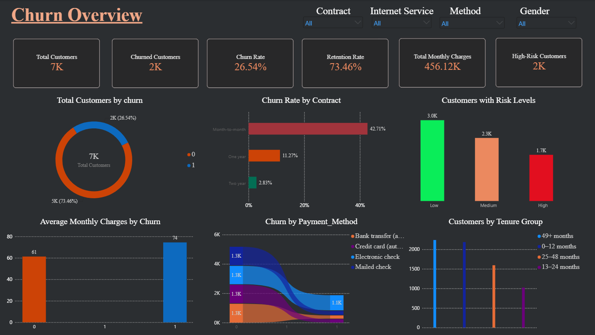
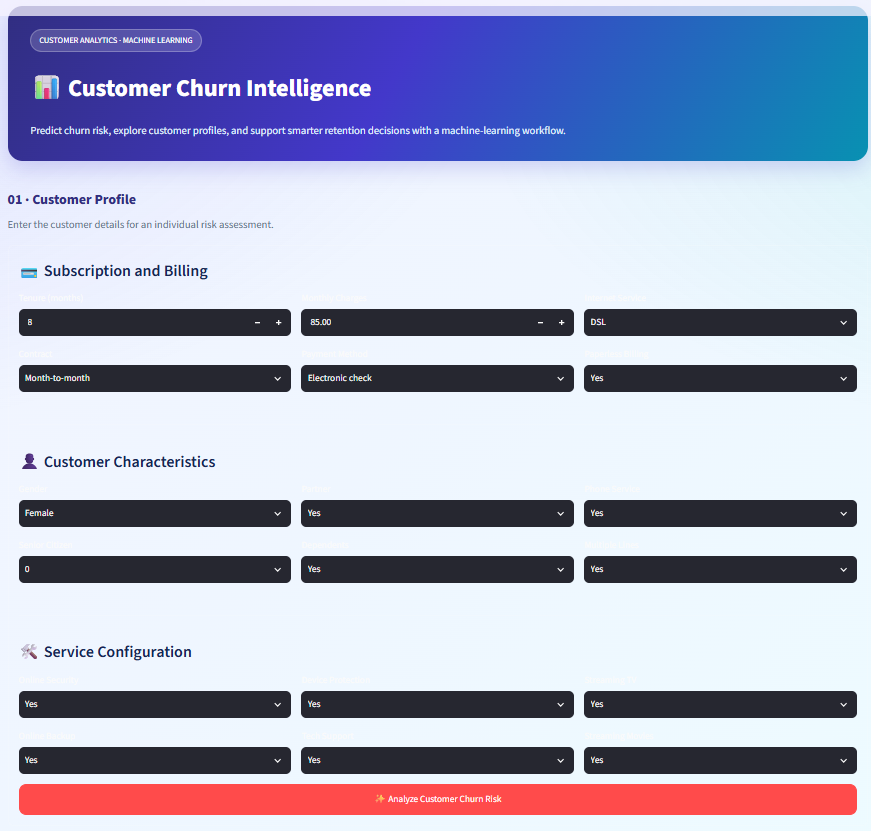
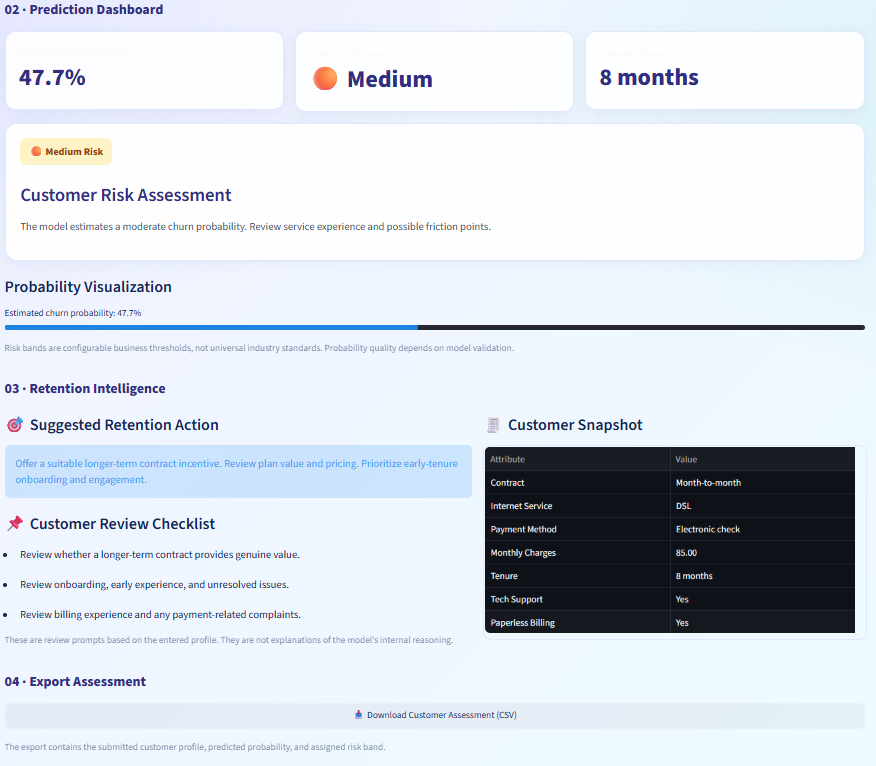

# Customer Churn Prediction & Retention Intelligence

### An End-to-End Data Science, Machine Learning & Business Intelligence Project

[](https://www.python.org/)
[](https://powerbi.microsoft.com/)
[](https://streamlit.io/)
[](https://pandas.pydata.org/)
[](https://scikit-learn.org/)

**Predict customer churn, identify customer risk levels, and support proactive retention decisions through data analytics, machine learning, and interactive business intelligence.**

---

## Table of Contents

- [Project Overview](#project-overview)
- [Dashboard Preview](#dashboard-preview)
- [Business Problem](#business-problem)
- [Project Objectives](#project-objectives)
- [Key Features](#key-features)
- [Technology Stack](#technology-stack)
- [Project Workflow](#project-workflow)
- [Dataset](#dataset)
- [Machine Learning](#machine-learning)
- [Power BI Dashboard](#power-bi-dashboard)
- [Streamlit Application](#streamlit-application)
- [Project Structure](#project-structure)
- [Installation and Execution](#installation-and-execution)
- [Model Evaluation](#model-evaluation)
- [Business Value](#business-value)
- [Limitations](#limitations)
- [Future Improvements](#future-improvements)
- [Author](#author)

---

## Project Overview

Customer churn is a significant challenge for subscription-based businesses. When customers discontinue their services, businesses can lose recurring revenue and may need to spend additional resources acquiring replacements.

The **Customer Churn Prediction & Retention Intelligence** project explores customer churn patterns and develops an analytical workflow to support customer retention decisions.

The project combines Python-based data preparation, machine learning, customer risk-level classification, retention recommendation logic, a Streamlit application, and Power BI reporting.

The goal is to demonstrate how customer data can be transformed into understandable insights and actionable retention priorities.

## Dashboard Preview

### 1. Power BI — Executive Overview



This dashboard preview presents the main customer churn indicators and business insights available in the completed report.

### 2. Power BI — Churn Analysis


Explore churn patterns across the customer attributes, services, contracts, and billing categories represented in the report.

### 3. Power BI — Customer Risk Analysis and predictions


Review customer risk-level distributions and the retention-related insights implemented in the dashboard.

### 4. power Bi — customer segment


### 5. Streamlit Application




The Streamlit interface connects the implemented prediction functionality with customer risk classification and retention recommendations.

> Replace these image references with screenshots of your actual Power BI report and Streamlit application. Remove any section for which you do not have a corresponding screenshot.

---

## Business Problem

Businesses need to understand which customer segments are associated with churn and how customer data can support better retention decisions.

Questions explored in this project include:

- What proportion of customers have churned?
- Which customer characteristics are associated with churn?
- How do contract types and service choices relate to churn?
- Which customers are assigned higher risk levels by the implemented workflow?
- How can customer risk information support retention prioritization?

The project approaches these questions through data analysis, predictive modeling, and business intelligence visualization.

## Project Objectives

- Clean and prepare customer data for analysis.
- Explore churn patterns and customer characteristics.
- Develop and evaluate a machine learning model for churn prediction.
- Classify customers using the implemented risk-level logic.
- Generate suggested retention actions using the implemented strategy.
- Present business insights through Power BI.
- Provide an interactive interface through Streamlit.
- Document the workflow for reproducibility and portfolio review.

## Key Features

| Feature | Description |
|---|---|
| Data preprocessing | Clean and prepare customer records |
| Exploratory data analysis | Investigate customer behavior and churn patterns |
| Machine learning | Train and evaluate the implemented churn model |
| Risk-level classification | Identify customer risk categories |
| Retention recommendations | Generate suggested actions using project-defined logic |
| Power BI dashboard | Explore churn and risk-related insights |
| Streamlit application | Interact with supported prediction functionality |
| SQL analysis | Run documented queries where implemented |
| Testing | Validate implemented functionality using available tests |

## Technology Stack

| Technology | Purpose |
|---|---|
| Python | Data analysis and model development |
| Pandas and NumPy | Data manipulation |
| Scikit-learn | Machine learning, if used by the implemented pipeline |
| Jupyter Notebook | Data exploration and experimentation |
| Streamlit | Interactive Python application |
| Power BI | Business intelligence and dashboard reporting |
| SQL | Data querying, where implemented |
| Git and GitHub | Version control and documentation |

See `requirements.txt` for the Python dependencies used by the project.

## Project Workflow

```text
Original Telco Customer Churn Dataset
                 |
                 v
       Data Cleaning and EDA
                 |
                 v
        Processed Customer Data
                 |
                 v
      Feature Preparation and Model
                 |
                 v
       Prediction and Risk Levels
                 |
                 v
       Retention Recommendation Logic
                 |
          +------+------+
          |             |
          v             v
   Streamlit App    Power BI Report
          |             |
          +------+------+
                 |
                 v
       Retention Decision Support
```

This diagram represents the intended project workflow. Refer to the notebooks and source code for the exact implementation and execution order.

## Dataset

The project uses the Telco Customer Churn dataset.

The principal CSV files are:

| File | Description |
|---|---|
| `WA_Fn-UseC_-Telco-Customer-Churn.csv` | Original customer dataset |
| `telco_churn_clean.csv` | Cleaned customer dataset |
| `customer_risk_scores.csv` | Customer risk output |

The risk output uses a **risk-level field**. The exact column names, risk categories, and any additional fields should be confirmed from the actual CSV schema.

Dataset locations and preprocessing details are documented in `data/README.md`.

Redistribution of the source data is subject to its applicable terms.

## Machine Learning

The project includes a machine learning workflow for customer churn prediction, together with the implemented customer risk classification functionality.

The modeling documentation should describe:

- Target variable and input features
- Data preprocessing and feature preparation
- Model algorithm and configuration
- Training and test-set methodology
- Evaluation metrics
- Risk-level classification logic

Only algorithms, features, and procedures present in the actual implementation should be listed as completed work.

## Power BI Dashboard

The Power BI report communicates customer churn and retention-related patterns through interactive visuals.

The completed report can be found in the `dashboard/` directory.

**Dashboard features:** Document the actual report pages, filters, KPIs, and measures here.

**Dashboard screenshots:** See the `images/` directory.

**Opening the report:** Open the `.pbix` file in Power BI Desktop and update the CSV source paths if necessary.

## Streamlit Application

The Streamlit application provides an interactive interface for the prediction and retention functionality implemented in Python.

Application code is maintained in `app/`, while reusable logic is organized in `src/`.

See `app/README.md` and `EXECUTION_GUIDE.md` for setup and execution details.

## Project Structure

```text
customer-churn-prediction-retention-intelligence/
│
├── app/             # Streamlit application
├── dashboard/       # Power BI report and dashboard assets and screenshots
├── data/            # Raw and processed datasets
├── images/          # application screenshots
├── models/          # Trained model and supporting artifacts
├── notebooks/       # Analysis and modeling notebooks
├── reports/         # Evaluation results and analytical reports
├── sql/             # SQL queries, where applicable
├── src/             # Reusable Python source modules
├── tests/           # Automated tests
│
├── .gitignore
├── EXECUTION_GUIDE.md
├── LICENSE
├── README.md
└── requirements.txt
```

## Installation and Execution

### Step 1: Clone the repository

```bash
git clone https://github.com/dustuai/customer-churn-prediction-retention-intelligence.git
cd customer-churn-prediction-retention-intelligence
```

Replace `YOUR_USERNAME` with your GitHub username.

### Step 2: Create a virtual environment

```bash
python -m venv .venv
```

Windows:

```bash
.venv\Scripts\activate
```

macOS/Linux:

```bash
source .venv/bin/activate
```

### Step 3: Install dependencies

```bash
python -m pip install --upgrade pip
pip install -r requirements.txt
```

### Step 4: Run the Streamlit application

Use the actual application entry-point filename.

For example, if the file is `app/streamlit_app.py`:

```bash
streamlit run app/streamlit_app.py
```

Replace the example filename with the real file in your project.

### Step 5: Explore the notebooks

```bash
jupyter notebook
```

Open the notebooks in `notebooks/` and follow their documented execution order.

### Step 6: Open the Power BI report

Open the `.pbix` report from `dashboard/` in Power BI Desktop. Update data source paths and refresh the report if required.

For complete instructions, see `EXECUTION_GUIDE.md`.

## Model Evaluation

Report the actual evaluation metrics obtained from the model's test or validation results.

          precision    recall  f1-score   support

       0       0.88      0.76      0.81      1035
       1       0.51      0.71      0.60       374

       accuracy                           0.75      1409
       macro avg       0.70      0.74     0.71      1409
       weighted avg    0.78      0.75     0.76      1409


Replace placeholders with verified values or remove metrics that have not been calculated. Explain the evaluation methodology and any class imbalance considerations.

## Business Value

The project demonstrates how analytics and predictive modeling can help businesses:

- Identify customer segments associated with higher churn.
- Prioritize retention outreach using risk classifications.
- Explore customer behavior and service patterns.
- Present data-driven insights to business stakeholders.
- Structure customer retention recommendations.

These are potential applications of the workflow, not guaranteed improvements in customer retention or revenue.

## Limitations

- The dataset may not represent all telecommunications businesses.
- Model performance depends on the dataset, feature preparation, and evaluation methodology.
- Risk classifications are estimates and do not guarantee future customer behavior.
- Retention recommendations require business validation.
- Historical associations do not establish causation.
- Real-world business impact requires measurement using operational data.

## Future Improvements

- Compare additional machine learning algorithms.
- Add model explainability and feature importance.
- Improve automated testing and reproducibility.
- Monitor model performance and data drift.
- Explore customer lifetime value and retention campaign outcomes.
- Deploy the Streamlit application.
- Measure the effectiveness of retention recommendations.

## Author

**Sayan Panda**

- GitHub: https://github.com/dustuai
- LinkedIn: https://www.linkedin.com/in/sayanpanda3004/


## License

See the `LICENSE` file for the project's licensing terms. Third-party datasets and assets may have separate conditions.

## Acknowledgements

Thanks to the creators of the Telco Customer Churn dataset and the maintainers of the open-source technologies used in this project.
